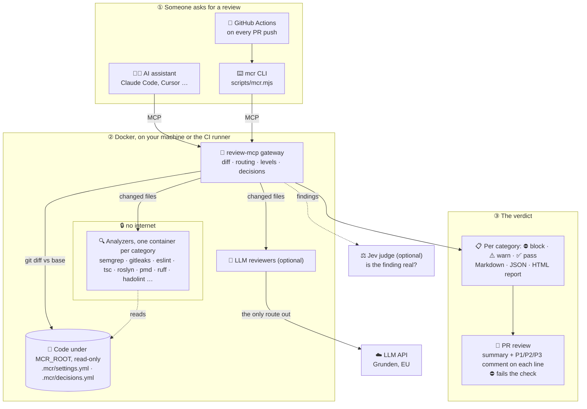

# multi-code-review

**A code reviewer that works on any codebase, in any language, the same way.**
It checks a change for six things: **security, architecture, best-practices,
testing, correctness and reliability**. It also remembers what your team has
decided about its findings.

---

## The short version (ELI5)

Think of a team of specialist inspectors checking a house before you move in.

- 🔍 **Inspectors (analyzers).** Each one knows one trade and one material:
  an electrician for Java, a plumber for C#, and so on. They check by the
  rulebook, so they are fast and always give the same answer. They work in a
  sealed room with no phone (no internet), so your code never leaves your
  machine through them.
- 🧠 **The senior reviewer (an LLM, optional).** Reads the change like a
  person and catches what no rulebook covers. Without a key for it, your own
  AI assistant does this part.
- ⚖️ **The judge (Jev, optional).** Takes a quick look at every complaint and
  asks whether it is a real problem or a guess. It can calm a complaint down,
  but never make one worse, and never for security.
- 📒 **The notebook (`.mcr/decisions.yml`).** When the team says "we do this on
  purpose" or "that tool is wrong here", it is written down. Next time the
  inspectors do not complain about it again.
- 🎚️ **The dial (`.mcr/settings.yml`).** For each of the six areas, set how
  strict the review is: off, minimum, medium or maximum.

You run **one command**. It looks at your code, works out which languages you
use, and calls in only the inspectors you need:

```bash
aspire start        # with a dashboard and all logs, or
./setup.sh          # Docker only
```

Your AI assistant (Claude Code, Cursor, Codex, Copilot …) then asks it to
"review my changes" and gets back a verdict per area:

```
| Category     | Verdict | Findings |
|--------------|---------|----------|
| security     | ✅ pass  | 0        |
| testing      | ⚠️ warn  | 1        |
| reliability  | ⛔ block | 1        |
```

### How it all fits together



1. Something asks for a review: your assistant over MCP, the `mcr` CLI, or
   the GitHub workflow (which runs the CLI).
2. The gateway diffs the branch against its base and sends only the changed
   files to the analyzers that understand them. The analyzers have no internet.
3. Optional: LLM reviewers read the change like a person; Jev judges whether
   each finding is real. Models may only soften a verdict, never add blocking.
4. The repo's decisions (`.mcr/decisions.yml`) are applied, and the result is a
   verdict per category. In a pull request it becomes a review with a comment
   on each line, and a ⛔ fails the check.

---

## What it covers

| Language | Analyzers (each runs as one container per category) |
|---|---|
| All languages | semgrep (rules for most languages), gitleaks (secrets), plus the optional LLM reviewer |
| JavaScript / TypeScript | the repo's own ESLint and TypeScript (`tsc`) |
| Java / Kotlin | PMD, detekt; Spring (code and `application*.properties`/`.yml`) through our own semgrep rules |
| C# / VB.NET | Roslyn analyzers (a real build, offline); SARIF from CI |
| PHP | PHPStan |
| C / C++ | cppcheck |
| Python | Ruff, Bandit |
| Ruby | RuboCop, Brakeman |
| Go | golangci-lint (incl. gosec) |
| Dockerfiles | hadolint (with ShellCheck on `RUN`) |
| Cloud IaC: AWS, Azure, GCP | checkov, offline (Terraform, Bicep/ARM, CloudFormation/SAM, Serverless) |

`detect_stack` and `./setup.sh` show, per language and category, which
analyzer covers it and where only a model does.

## Get started

**Needs:** Docker. For the dashboard: the [Aspire CLI](https://aspire.dev).
Every repo you review must be under `MCR_ROOT` (default `~/Source`).

```bash
aspire start                 # builds, scans the code, starts what it needs
node scripts/status.mjs      # MCP URL, tools, dashboard link
```

Or without Aspire:

```bash
./setup.sh                   # scan all of MCR_ROOT, start what it needs
./setup.sh ~/Source/acme     # scan just these repos
./setup.sh --offline         # no LLM, no Jev: no code leaves the machine
./setup.sh --dry-run         # report and .env only
```

**Read a review:** every review has a page for people at
`http://127.0.0.1:7700/reports/R-xxxxxxxx` (verdicts, the Jev fix list, every
finding with its code); `run_review` puts the link first
(`📄 **Full report:** …`), and
`http://127.0.0.1:7700/reports` lists them. Right after each review the
gateway stores the page, code included, in the **report-store** container
(volume `reports`), so the link still works after a restart or once the repo
is gone. Pages are deleted after `MCR_REPORT_TTL_DAYS` (default **7**, set it
in `.env`). report-store sits on its own internal network with only the
gateway: no host port, and the analyzers and LLM reviewers cannot reach it.
The pages are served only through the gateway, to allowed hosts.

**Optional keys** (Docker secrets, `secrets/` is gitignored):

| File | Turns on |
|---|---|
| `secrets/llm_api_key` | One LLM reviewer per category. Any OpenAI-compatible API; default [Grunden](https://grunden.ai) (EU) with `glm-5.3-flash`. Set `MCR_LLM_BASE_URL` / `MCR_LLM_MODEL` in `.env` |
| `secrets/typesafe_api_key` | [Jev](https://typesafe.ai) as judge: is a finding real, is a model finding speculative, how risky is the diff |

**Connect your AI assistant:**

- **Claude Code:** install this repo as a plugin (it ships `.mcp.json` and the
  skills), or
  `claude mcp add --transport http multi-code-review http://127.0.0.1:7700/mcp`.
- **Others:** a streamable-HTTP MCP server at `http://127.0.0.1:7700/mcp`. Give
  the agent `skills/multi-code-review/SKILL.md` as instructions.

**From a terminal or CI** (no assistant; the gateway must be running):

```bash
node scripts/mcr.mjs review                          # this repo, diff vs the default base
node scripts/mcr.mjs review ~/Source/acme --base origin/main --out review.md
node scripts/mcr.mjs fix-report --json               # also: triage, detect, analyzers
```

Exit 0 passed, 1 blocking (`--strict`: also when an analyzer failed), 2 usage
error or no gateway. `--out` writes the Markdown report; `--github-review` writes
a GitHub pull request review (see [Pull requests on GitHub](#pull-requests-on-github)).

Skills: `skills/multi-code-review` (review, triage, decide) and
`skills/start-app` (start the service and report where it answers).

## Day to day

1. **Review:** ask your assistant to review the branch. It calls `run_review`.
2. **Read the verdict:** ⛔ blocking, ⚠️ warn, ℹ️ info, ✔️ accepted by a team
   decision, 📋 decided to fix.
3. **Decide:** for anything the team disagrees with, `triage_queue` walks
   through it rule by rule. `record_decisions` writes `.mcr/decisions.yml`.
   You commit that file and it is reviewed like code.
4. **Tune:** set the level per category in `.mcr/settings.yml`.

### Levels (`.mcr/settings.yml`)

```yaml
review:
  security: maximum
  architecture: medium
  best-practices: minimum
  testing: medium
  correctness: medium
  reliability: medium
```

| Level | Runs | Shows | Blocks |
|---|---|---|---|
| off | nothing | – | – |
| minimum | analyzers | high | high |
| medium (default) | analyzers + LLM reviewer (not on trivial diffs) | high, medium | high |
| maximum | analyzers + LLM reviewer on every diff | everything | high, medium |

`MCR_LEVELS=security=maximum,…` in `.env` sets the default for repos without
the file. See `examples/settings.yml`.

### Decisions (`.mcr/decisions.yml`)

```yaml
decisions:
  - id: D-0002
    action: accept            # fix | accept | false-positive | disable
    match:
      rule: semgrep:javascript.browser.security.eval-detected   # tool:ruleId
      fingerprint: 6e14…      # one occurrence; or paths: [globs]; or neither: whole repo
      paths: [src/calc/evaluate.ts]
    reason: Sandboxed evaluator, input is never user-controlled
    ref: docs/adr/0009-eval.md
    decided_by: Per Hassle
    decided_on: 2026-10-13
    expires_on: 2027-06-30    # optional: findings come back after this
```

- **accept** (valid, on purpose) and **false-positive** (the tool is wrong)
  never block. They show with their reason.
- **disable** hides the rule in its scope and counts it.
- **fix** keeps it on the to-fix list. When it is gone, `fix_report` says the
  decision can go.
- An occurrence matches on tool, rule, file and the flagged code, not the line
  number. Moving code keeps the decision. Rewriting the flagged line brings the
  finding back for a new decision.
- The most specific decision wins: occurrence, then paths, then the whole repo.
- Keys use the tool, not the container, so renaming or splitting containers
  keeps every decision.

## Pull requests on GitHub

`.github/workflows/review.yml` is a reusable workflow. On every push to a pull
request it starts the stack on the runner, reviews the PR head against its
base, and posts a **pull request review**: a summary with the verdict per
category, and a comment on the line of each new finding, ranked **P1** (blocks),
**P2** (warns) or **P3** (informs). A finding is commented once; later pushes do
not repeat it, and findings the team accepted are not commented at all. A
blocking finding fails the check. Under the verdict the review links **Full
report**, the run's job summary with every finding and its code (opens in the
browser), and **HTML**, the readable page as a single file. HTML and JSON are
also attached to the run as one zip.

To use it in a repo, copy [`examples/github-workflow.yml`](examples/github-workflow.yml)
to `.github/workflows/code-review.yml` and add the secrets it names. `prepare`
installs dependencies first (e.g. `npm ci`), since the analyzers have no network.
This repo reviews its own pull requests with `.github/workflows/self-review.yml`.

Without `llm_api_key` and `typesafe_api_key` (or with `offline: true`) no code
leaves the runner.

## Logs and the dashboard

Under Aspire every container is its own resource with its own logs:

```bash
aspire describe                   # state, health, a dashboard link per resource
aspire logs review-mcp            # the gateway
aspire logs correctness-llm       # one analyzer
aspire logs stack                 # docker compose: builds, starts, errors
```

`review-mcp` shows the MCP endpoint, health and links in the dashboard. The
`stack` resource has a **Rescan codebase** command for when a new language
shows up.

---

## Technical reference

### Architecture

```
harness ──MCP/HTTP──▶ review-mcp gateway (127.0.0.1:7700)
                        │  git diff · risk tier · routing · levels
                        │  decisions · Jev judge · report
          ┌─────────────┼───────────────────────────┐
          ▼ network "analyzers"                     ▼ network "llm"
            internal, no egress                       internal
   security-semgrep  correctness-roslyn …      security-llm … ──▶ llm-egress ──▶ LLM API
   one container per category: <category>-<tool>
```

- **Docker Compose** runs everything (`compose.yaml`). Services without a
  profile (`core`) always run. The others run when their profile is in
  `COMPOSE_PROFILES`, which `setup.sh` writes to `.env` after scanning.
- **Aspire** (`aspire-apphost/apphost.mts`, TypeScript) wraps the same compose
  stack instead of running the containers itself, because Aspire's container
  network has egress. It adds one log resource per container from
  `gateway/src/catalog.ts`.
- **`gateway/src/catalog.ts`** is the single list of containers and profiles.
  A test keeps `compose.yaml` in sync with it.
- **Containers** are `read_only`, with `cap_drop: ALL` and `no-new-privileges`.
  `MCR_ROOT` is mounted read-only at the same path as on the host. Only the
  `*-llm` containers have a route out, and only to the LLM API.

### Review pipeline (`gateway/src/review.ts`)

1. **Diff:** what changed since the merge base (committed, staged, unstaged,
   untracked), or `scope: "all"` for a baseline.
2. **Risk tier:** `trivial | lite | full`, from size and sensitive paths
   (`auth/`, `crypto/`, migrations, CI …). With Jev, a typed score that may
   lower the tier by at most one step and never for sensitive paths. Trivial
   diffs skip the LLM reviewers unless the level is `maximum`.
3. **Levels:** `.mcr/settings.yml` decides which analyzers run per category.
4. **Analyzers in parallel:** each gets `{ root, files, changes }` and returns
   SARIF. Findings off the changed files are dropped.
5. **Classify:** fingerprint and new or pre-existing. Blocking means new,
   severity at the category's blocking level, and no accepting decision.
6. **Decisions:** `.mcr/decisions.yml` is applied, most specific first.
7. **Judge (Jev):** for new, undecided findings, a typed `real` probability,
   and for model findings `concrete`, `speculative` and `style`. Policy is in
   code (`judge.ts`): below P(real) 0.15 a non-security block becomes "needs a
   human". Speculative model findings become info. A model never adds
   blocking.
8. **Report:** Markdown with a verdict per category, plus JSON.

### MCP tools

| Tool | Does |
|---|---|
| `list_analyzers` | Containers, their category, languages, extensions |
| `detect_stack` | A repo's stacks, which analyzer covers each category, and profiles that should run but do not |
| `run_review` | Diff vs base, or `scope: "all"`. Runs every matching container in parallel, applies decisions, returns a verdict per category and the findings |
| `run_analyzer` | The same with named containers only |
| `get_finding` | Full detail for one `F-xxxxxxxx` from a recent review |
| `triage_queue` | Undecided findings grouped by rule: the agenda for deciding with the user |
| `record_decisions` | Turns the user's choices into the new `.mcr/decisions.yml`. It returns the file; the harness writes it |
| `apply_decisions` | Matches the harness's own model findings (`llm:<slug>`) against the decisions |
| `fix_report` | Checklist: to fix, undecided, accepted with reasons, decisions that can go |

### Profiles and analyzers

| Profile | Starts when | Containers |
|---|---|---|
| core | always | `{security,best-practices,correctness,reliability}-semgrep`, `security-gitleaks` (secrets in the files under review, redacted; repo `.gitleaks.toml` if any) |
| node | JS/TS found | `*-eslint` (all six), `correctness-tsc`, from the repo's own `node_modules` |
| jvm | Java/Kotlin found | `*-pmd` (Java, repo ruleset if any), `*-detekt` (Kotlin, `.kt`/`.kts`, repo `detekt.yml` if any) |
| dotnet | C#/VB.NET found | `*-roslyn`: `dotnet build --no-restore` into `/tmp`, from the host's `obj/project.assets.json` and NuGet cache (mounted read-only); also `.mcr/sarif/**/*.sarif` |
| php | PHP found | `*-phpstan` (repo `phpstan.neon` if any, else level 5) |
| cpp | C/C++ found | `*-cppcheck` |
| python | Python found | `*-ruff`, `security-bandit` (Ruff's S rules are left to Bandit) |
| ruby | Ruby found | `*-rubocop`, `security-brakeman` |
| go | Go found | `*-golangci-lint`, from the host's module cache (`go mod download` first) |
| infra | Dockerfiles, compose, workflows, Terraform, Bicep or cloud templates found | `best-practices-hadolint` (repo `.hadolint.yaml` if any); `security-checkov`, `reliability-checkov` (repo `.checkov.yaml` if any, `checkov:skip=` comments) |
| llm | `secrets/llm_api_key` | `<category>-llm` for all six |

- checkov has no severity offline, so the adapter grades its checks: data open
  to anyone, admin ports open to the internet, admin rights, plaintext transport
  and hard-coded secrets are high (they block); other misconfiguration medium;
  hardening (own KMS keys, logging, descriptions) low. Backups and deletion
  protection go to reliability (medium), Multi-AZ and replication low.
  Terraform is scanned per module directory, templates per file; JSON and YAML
  count only when they look like CloudFormation, SAM, Serverless or ARM.
- Each tool maps its own rule groups onto the six categories (e.g. Roslyn
  `Security`/`Reliability`/`Design`, RuboCop `Lint`/`Security`, detekt
  `potential-bugs`/`coroutines`). The repo's own linter config is the norm
  wherever the tool has one.
- **semgrep:** [semgrep-rules](https://github.com/semgrep/semgrep-rules) baked
  in at a pinned commit and split by category at build time. The rules license
  allows internal use only and no redistribution, so build the image locally
  and never push it to a registry.
  Our own rules sit in `analyzers/semgrep/rules/<category>/` with a test
  target next to each (`ruleid:`/`ok:` comments); the image build runs
  `semgrep --test` on them and serves them as `mcr.<path>.<rule>`. Today:
  Spring (SpEL injection, CSRF off, `anyRequest().permitAll()`, weak
  `PasswordEncoder`, CORS `*`, secrets and stack traces in config, proxy
  annotations on private methods, field injection).

### Model budgets

- **LLM reviewer:**
  - The first prompt takes at most 40% of `MCR_LLM_CONTEXT_TOKENS` (default
    190k, Grunden's limit). It is asked for its report at 80%, or after half
    of `MCR_LLM_DEADLINE_MS` (45 s).
  - It has read-only tools only (`read_file`, `list_dir`, `grep`) and reports
    through a fixed `report_findings` schema.
  - Findings off changed lines, or with confidence below 0.5, are dropped.
  - High severity needs confidence ≥ 0.8.
- **Jev:** every request stays under 32k tokens. Long lines and distant code
  are trimmed first. The model is pinned (`jev-1.13.0`) so verdicts can be
  replayed.

### Configuration

| Variable | Default | |
|---|---|---|
| `MCR_ROOT` | `$HOME/Source` | What the analyzers can read |
| `MCR_PORT` | `7700` | Port published on 127.0.0.1 |
| `MCR_LEVELS` | all `medium` | Default level per category |
| `MCR_LLM_BASE_URL`, `MCR_LLM_MODEL` | Grunden, `glm-5.3-flash` | Any OpenAI-compatible API |
| `MCR_LLM_DEADLINE_MS`, `MCR_LLM_CONTEXT_TOKENS` | `45000`, `190000` | LLM time and context budget |
| `MCR_JEV` | `on` | `off` disables the judge |
| `MCR_NUGET_PACKAGES`, `MCR_GOMODCACHE` | `~/.nuget/packages`, `~/go/pkg/mod` | Host caches for .NET and Go |

### Adding an analyzer

1. Create `analyzers/<tool>/adapter.mjs` and a Dockerfile (build context
   `analyzers/`, pinned versions, non-root, no network at run time). The
   adapter exports `info` and
   `analyze({ root, files, changes, category }) -> { findings, notes }` and
   calls `serve()` from `analyzers/_kit/serve.mjs`. The kit handles HTTP, path
   checks, the one-category filter and SARIF.
2. Add one `<category>-<tool>` service per category to `compose.yaml` under a
   profile, and the same entries to `gateway/src/catalog.ts`.
3. Map the stack in `gateway/src/detect.ts` (extensions, manifests, profile).
4. Test the pure parts next to the adapter (`adapter.test.mjs`).

`analyzers/gitleaks` (core, any file) and `analyzers/hadolint` (its own
`infra` profile) are the smallest complete examples: copy the tool's binary
from its official image, turn its JSON into findings, done. Each answers in
milliseconds.

**Next analyzers.** Each fits the same contract; most read source only, so
they stay offline and fast:

| Container | Profile | How it plugs in |
|---|---|---|
| `security-osv` | core | osv-scanner on lockfiles with `--offline`; the vulnerability database is downloaded at image build, so rebuild to refresh it. Report on the lockfile line of the package, so a newly added vulnerable dependency blocks |
| `security-zizmor` | infra | `zizmor --offline --format sarif` on `.github/workflows/*.yml` and `action.yml` |
| `architecture-depcruise` | node | dependency-cruiser with the repo's `.dependency-cruiser.*`, else a default set (no cycles, no unresolvable or undeclared imports); a violation lands on the import line |
| `architecture-packwerk` | ruby | `pks check` (static Rust port of packwerk, no Rails boot) on repos with `packwerk.yml` |
| `architecture-archunit`, `architecture-netarchtest` | jvm, dotnet | These are tests the repo writes and runs itself; the container must not run repo code. It reads their results instead (JUnit XML from `target/surefire-reports`, `build/test-results`, TRX), and turns failed architecture tests into findings on the violating class (ArchUnit prints `(File.java:42)`) |
| `testing-coverage` | core | Diff coverage: read the coverage report the repo's tests already wrote (lcov, Cobertura, JaCoCo, Go cover profile, SimpleCov) and report changed lines no test runs. Never blocking. Skips a report older than the file |

### Develop

```bash
cd gateway && npm ci
npm test          # gateway and analyzer adapter tests
npm run typecheck
```

The gateway is TypeScript run directly by Node 24 (type stripping), with no
build step. Pure logic (`diff`, `findings`, `decisions`, `report`, `catalog`,
`detect`, `settings`, `judge`) has no I/O and is unit tested. Research and
design notes are in [docs/research/multi-language.md](docs/research/multi-language.md).

### Roadmap

1. ✅ Gateway, semgrep, eslint, tsc, skill.
2. ✅ Decisions, triage, fix report, one container per category.
3. ✅ Stack detection and one-command setup, analyzers for Java, Kotlin, C#,
   PHP, C/C++, Python, Ruby and Go, LLM reviewers, Jev judge, levels, Aspire.
4. Bot for GitHub and Azure DevOps: the same images in CI, one summary comment
   plus inline threads, and `/review accept|refute <reason>` to record
   decisions.
5. Jev as a first pass over every hunk (checklist questions per category),
   with the LLM only on what it flags (research §11).
6. More containers: ✅ `security-gitleaks`, ✅ `best-practices-hadolint`,
   ✅ `{security,reliability}-checkov`;
   next `security-osv`, `security-zizmor`, architecture tools
   (dependency-cruiser, ArchUnit, NetArchTest, packwerk) and diff coverage for
   testing (see [Adding an analyzer](#adding-an-analyzer)).
