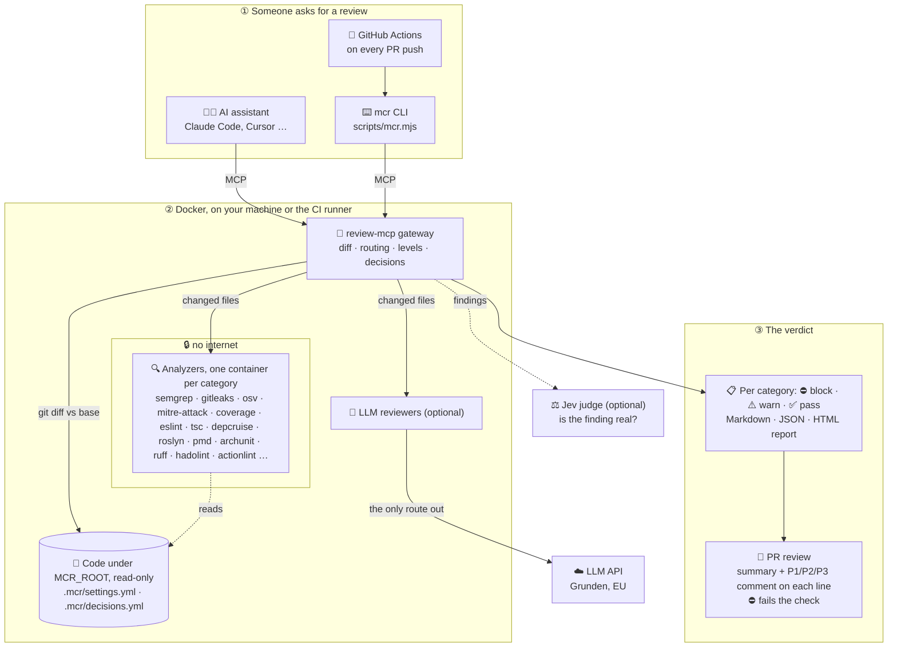

# multi-code-review

**A code reviewer that works on any codebase, in any language, the same way.**
It checks a change for six things: **security, architecture, best-practices,
testing, correctness and reliability**. It also remembers what your team has
decided about its findings.

> **About this repository.** This is a proof of concept, published to
> illustrate an idea: pull request review can be built mainly from fast,
> deterministic analyzers, with a language model added where judgment is
> needed (for example checking a change against the team's ADRs), and Jev
> deciding whether each finding is real. It shows what can be done; it is
> not a product. Take it, use it, change it and build on it under the
> [MIT License](LICENSE). It comes **as is**: no support, no warranty, and no
> responsibility for what it finds or misses. Use it as a starting point and
> check it fits your own needs before you rely on it.
>
> **Third-party rules.** This repository contains no Semgrep-maintained rules.
> The semgrep image fetches them from
> [semgrep/semgrep-rules](https://github.com/semgrep/semgrep-rules) at build
> time. They are licensed under the
> [Semgrep Rules License v1.0](https://semgrep.dev/legal/rules-license), which
> allows internal business use only. Build the image locally, and do not push
> it to a registry, share it, or run it as a service for others. Each analyzer
> image (semgrep engine, PMD, Ruff, gitleaks, osv-scanner, zizmor, actionlint,
> dependency-cruiser, pks, checkov and others) keeps its own license; the MIT License covers this repository's own
> code only.

---

## More code, same quality bar

Teams now ship far more code than before, much of it written by AI
assistants. If review does not keep up, the arithmetic is simple: more code at
the same defect rate means more bugs in production, in less time. The quality
bar has to rise with the volume, and that only works if most of the checking
is automatic, fast and the same every time. This repo tries out one way to do
that:

- **Deterministic first.** Analyzers give the same answer every time, in
  seconds, without internet. A language model adds judgment where rules cannot
  (a change against your ADRs), and Jev weighs whether each finding is real.
  Models may only soften a verdict, never add blocking, and never decide
  security on their own.
- **In the loop, not after it.** The assistant runs the review itself over MCP
  while it works. With the [agent gate](#the-agent-gate) on, a Claude Code
  agent cannot finish its turn while the review blocks: the findings go back
  to it, and it keeps working.
- **Aimed at what generated code gets wrong:** vulnerable dependencies, and
  packages attackers registered under names assistants tend to invent, once
  they are on OpenSSF's malicious-package list (osv); pasted secrets
  (gitleaks); code that behaves like an attack, such as install hooks,
  backdoors and exfiltration (MITRE ATT&CK rules); injectable CI workflows
  (zizmor); and changed lines that no test runs (diff coverage).
- **It remembers.** Team decisions live in `.mcr/decisions.yml` and are
  reviewed like code. The hundredth pull request does not reopen what the
  team settled on the first.
- **The same gate everywhere:** the same containers run on a laptop, behind
  the assistant, and on every pull request.

---

## The short version (ELI5)

Think of a team of specialist inspectors checking a house before you move in.

- 🔍 **Inspectors (analyzers).** Each one knows one trade and one material:
  an electrician for Java, a plumber for C#, and so on. They check by the
  rulebook, so they are fast and always give the same answer. They work in a
  sealed room with no phone (no internet), so your code never leaves your
  machine through them.
- 🧠 **The senior reviewer (an LLM, optional).** Reads the change like a
  person and catches what no rulebook covers. Without a key for it, your own
  AI assistant does this part.
- ⚖️ **The judge (Jev, optional).** Takes a quick look at every complaint and
  asks whether it is a real problem or a guess. It can calm a complaint down,
  but never make one worse, and never for security.
- 📒 **The notebook (`.mcr/decisions.yml`).** When the team says "we do this on
  purpose" or "that tool is wrong here", it is written down. Next time the
  inspectors do not complain about it again.
- 🎚️ **The dial (`.mcr/settings.yml`).** For each of the six areas, set how
  strict the review is: off, minimum, medium or maximum.

You run **one command**. It looks at your code, works out which languages you
use, and calls in only the inspectors you need:

```bash
aspire start        # with a dashboard and all logs, or
./setup.sh          # Docker only
```

Your AI assistant (Claude Code, Cursor, Codex, Copilot …) then asks it to
"review my changes" and gets back a verdict per area:

```
| Category     | Verdict | Findings |
|--------------|---------|----------|
| security     | ✅ pass  | 0        |
| testing      | ⚠️ warn  | 1        |
| reliability  | ⛔ block | 1        |
```

### How it all fits together



1. Something asks for a review: your assistant over MCP, the `mcr` CLI, or
   the GitHub workflow (which runs the CLI).
2. The gateway diffs the branch against its base and sends only the changed
   files to the analyzers that understand them. The analyzers have no internet.
3. Optional: LLM reviewers read the change like a person; Jev judges whether
   each finding is real. Models may only soften a verdict, never add blocking.
4. The repo's decisions (`.mcr/decisions.yml`) are applied, and the result is a
   verdict per category. In a pull request it becomes a review with a comment
   on each line, and a ⛔ fails the check.

---

## What it covers

| Language | Analyzers (each runs as one container per category) |
|---|---|
| All languages | semgrep (rules for most languages), gitleaks (secrets), osv (vulnerable and known-malicious dependencies, from lockfiles), MITRE ATT&CK rules (backdoors, persistence, exfiltration), diff coverage (changed lines no test runs, from your own coverage report), plus the optional LLM reviewer |
| JavaScript / TypeScript | the repo's own ESLint and TypeScript (`tsc`); dependency-cruiser (cycles, unresolvable and undeclared imports, or the repo's own import rules); knip (unused files, exports and dependencies) |
| Java / Kotlin | PMD, detekt; Spring (code and `application*.properties`/`.yml`) through our own semgrep rules; failed ArchUnit tests, from the repo's own test results |
| C# / VB.NET | Roslyn analyzers (a real build, offline); SARIF from CI; failed NetArchTest / ArchUnitNET tests, from the repo's own TRX results |
| PHP | PHPStan; deptrac layer rules where there is a `deptrac.yaml` |
| C / C++ | cppcheck |
| Python | Ruff, Bandit; import-linter contracts where the repo has them |
| Ruby | RuboCop, Brakeman; packwerk boundaries (`pks check`) where there is a `packwerk.yml` |
| Go | golangci-lint (incl. gosec); go-arch-lint where there is a `.go-arch-lint.yml` |
| Dockerfiles | hadolint (with ShellCheck on `RUN`) |
| GitHub Actions | zizmor (template injection, permissions, unpinned actions, `pull_request_target`); actionlint (syntax, expressions, ShellCheck on `run:`) |
| Cloud IaC: AWS, Azure, GCP | checkov, offline (Terraform, Bicep/ARM, CloudFormation/SAM, Serverless) |
| Scala, Rust, Swift | semgrep only (plus the all-language rows); `detect_stack` names the analyzer that would come next |

`detect_stack` and `./setup.sh` show, per language and category, which
analyzer covers it and where only a model does.

## Get started

**Needs:** Docker. For the dashboard: the [Aspire CLI](https://aspire.dev).
Every repo you review must be under `MCR_ROOT` (default `~/Source`).

```bash
aspire start                 # builds, scans the code, starts what it needs
node scripts/status.mjs      # MCP URL, tools, dashboard link
```

Or without Aspire:

```bash
./setup.sh                   # scan all of MCR_ROOT, start what it needs
./setup.sh ~/Source/acme     # scan just these repos
./setup.sh --offline         # no LLM, no Jev: no code leaves the machine
./setup.sh --dry-run         # report and .env only
```

**Read a review:** every review has a page for people at
`http://127.0.0.1:7700/reports/R-xxxxxxxx` (verdicts, the Jev fix list, every
finding with its code); `run_review` puts the link first
(`📄 **Full report:** …`), and
`http://127.0.0.1:7700/reports` lists them. Right after each review the
gateway stores the page, code included, in the **report-store** container
(volume `reports`), so the link still works after a restart or once the repo
is gone. Pages are deleted after `MCR_REPORT_TTL_DAYS` (default **7**, set it
in `.env`). report-store sits on its own internal network with only the
gateway: no host port, and the analyzers and LLM reviewers cannot reach it.
The pages are served only through the gateway, to allowed hosts.

**Optional keys** (Docker secrets, `secrets/` is gitignored):

| File | Turns on |
|---|---|
| `secrets/llm_api_key` | One LLM reviewer per category. Any OpenAI-compatible API; default [Grunden](https://grunden.ai) (EU) with `glm-5.3-flash`. Set `MCR_LLM_BASE_URL` / `MCR_LLM_MODEL` in `.env` |
| `secrets/typesafe_api_key` | [Jev](https://typesafe.ai) as judge: is a finding real, is a model finding speculative, how risky is the diff |

**Connect your AI assistant:**

- **Claude Code:** install this repo as a plugin (it ships `.mcp.json` and the
  skills), or
  `claude mcp add --transport http multi-code-review http://127.0.0.1:7700/mcp`.
- **Others:** a streamable-HTTP MCP server at `http://127.0.0.1:7700/mcp`. Give
  the agent `skills/multi-code-review/SKILL.md` as instructions.

### The agent gate

The Claude Code plugin ships a Stop hook (`hooks/hooks.json`,
`scripts/stop-gate.mjs`). Each time the agent finishes a turn, it reviews the
repo the agent worked in. While the review blocks, the agent is not allowed to
stop: the blocking findings go back to it as the reason to keep working. The
agent is told to fix them, never to silence them: decisions stay with people.
The gate is opt-in per repo:

```yaml
# .mcr/settings.yml
agent:
  gate: true
```

`MCR_GATE=1` turns it on for every repo, and `MCR_GATE=0` turns it off. The
gate never traps the agent. If the gateway is down, the repo is outside
`MCR_ROOT` or the review fails, the agent may stop and you see a note. After
three blocked rounds in a row it hands over to you. Without the plugin, add
the same hook to `.claude/settings.json`, with the path to your checkout's
`scripts/stop-gate.mjs`.

**From a terminal or CI** (no assistant; the gateway must be running):

```bash
node scripts/mcr.mjs review                          # this repo, diff vs the default base
node scripts/mcr.mjs review ~/Source/acme --base origin/main --out review.md
node scripts/mcr.mjs fix-report --json               # also: triage, detect, analyzers
```

Other flags: `--all` (every file, not the diff), `--category` and
`--analyzer` (repeatable), `--preexisting` (also findings on unchanged lines),
`--json`, `--url`; `--help` lists them all.

Exit 0 passed, 1 blocking (`--strict`: also when an analyzer failed), 2 usage
error or no gateway. `--out` writes the Markdown report; `--github-review` writes
a GitHub pull request review (see [Pull requests on GitHub](#pull-requests-on-github)).

Skills: `skills/multi-code-review` (review, triage, decide) and
`skills/start-app` (start the service and report where it answers). Hook:
the [agent gate](#the-agent-gate).

## Day to day

1. **Review:** ask your assistant to review the branch. It calls `run_review`.
2. **Read the verdict:** ⛔ blocking, ⚠️ warn, ℹ️ info, ✔️ accepted by a team
   decision, 📋 decided to fix.
3. **Decide:** for anything the team disagrees with, `triage_queue` walks
   through it rule by rule. `record_decisions` writes `.mcr/decisions.yml`.
   You commit that file and it is reviewed like code.
4. **Tune:** set the level per category in `.mcr/settings.yml`.

### Levels (`.mcr/settings.yml`)

```yaml
review:
  security: maximum
  architecture: medium
  best-practices: minimum
  testing: medium
  correctness: medium
  reliability: medium
```

| Level | Runs | Shows | Blocks |
|---|---|---|---|
| off | nothing | – | – |
| minimum | analyzers | high | high |
| medium (default) | analyzers + LLM reviewer (not on trivial diffs) | high, medium | high |
| maximum | analyzers + LLM reviewer on every diff | everything | high, medium |

`MCR_LEVELS=security=maximum,…` in `.env` sets the default for repos without
the file. See `examples/settings.yml`.

### Decisions (`.mcr/decisions.yml`)

Each reviewed repo keeps its own file; the gateway reads it from the repo under
review, never from this one. The [`.mcr/decisions.yml`](.mcr/decisions.yml) here
holds this repo's own decisions (its self-review), and doubles as a real
example. Your repo starts without one; `record_decisions` (or `triage_queue`)
writes it.

```yaml
decisions:
  - id: D-0002
    action: accept            # fix | accept | false-positive | disable
    match:
      rule: semgrep:javascript.browser.security.eval-detected   # tool:ruleId
      fingerprint: 6e14…      # one occurrence; or paths: [globs]; or neither: whole repo
      paths: [src/calc/evaluate.ts]
    reason: Sandboxed evaluator, input is never user-controlled
    ref: docs/adr/0009-eval.md
    decided_by: Per Hassle
    decided_on: 2026-10-13
    expires_on: 2027-06-30    # optional: findings come back after this
```

- **accept** (valid, on purpose) and **false-positive** (the tool is wrong)
  never block. They show with their reason.
- **disable** hides the rule in its scope and counts it.
- **fix** keeps it on the to-fix list. When it is gone, `fix_report` says the
  decision can go.
- An occurrence matches on tool, rule, file and the flagged code, not the line
  number. Moving code keeps the decision. Rewriting the flagged line brings the
  finding back for a new decision.
- The most specific decision wins: occurrence, then paths, then the whole repo.
- Keys use the tool, not the container, so renaming or splitting containers
  keeps every decision.

## Pull requests on GitHub

`.github/workflows/review.yml` is a reusable workflow. On every push to a pull
request it starts the stack on the runner, reviews the PR head against its
base, and posts a **pull request review**: a summary with the verdict per
category, and a comment on the line of each new finding, ranked **P1** (blocks),
**P2** (warns) or **P3** (informs). A finding is commented once; later pushes do
not repeat it, and findings the team accepted are not commented at all. A
blocking finding fails the check. Under the verdict the review links **Full
report**, the run's job summary with every finding and its code (opens in the
browser), and **HTML**, the readable page as a single file. HTML and JSON are
also attached to the run as one zip.

This is how a calling repo is wired: see
[`examples/github-workflow.yml`](examples/github-workflow.yml), placed as
`.github/workflows/code-review.yml` with the secrets it names. `prepare`
installs dependencies first (e.g. `npm ci`), since the analyzers have no network.
This repo reviews its own pull requests with `.github/workflows/self-review.yml`.

Without `llm_api_key` and `typesafe_api_key` (or with `offline: true`) no code
leaves the runner.

## Logs and the dashboard

Under Aspire every container is its own resource with its own logs:

```bash
aspire describe                   # state, health, a dashboard link per resource
aspire logs review-mcp            # the gateway
aspire logs correctness-llm       # one analyzer
aspire logs stack                 # docker compose: builds, starts, errors
```

Without Aspire, use the service name with compose, or the container name
(always `multi-code-review-<service>`) with docker:

```bash
docker compose logs security-mitre-attack
docker logs multi-code-review-review-mcp
```

`review-mcp` shows the MCP endpoint, health and links in the dashboard. The
`stack` resource has a **Rescan codebase** command for when a new language
shows up.

---

## Technical reference

### Architecture

```
harness ──MCP/HTTP──▶ review-mcp gateway (127.0.0.1:7700)
                        │  git diff · risk tier · routing · levels
                        │  decisions · Jev judge · report
          ┌─────────────┼───────────────────────────┐
          ▼ network "analyzers"                     ▼ network "llm"
            internal, no egress                       internal
   security-semgrep  correctness-roslyn …      security-llm … ──▶ llm-egress ──▶ LLM API
   one container per category: service <category>-<tool>,
   container multi-code-review-<category>-<tool>
```

- **Docker Compose** runs everything (`compose.yaml`). Services without a
  profile (`core`) always run. The others run when their profile is in
  `COMPOSE_PROFILES`, which `setup.sh` writes to `.env` after scanning.
- **Aspire** (`aspire-apphost/apphost.mts`, TypeScript) wraps the same compose
  stack instead of running the containers itself, because Aspire's container
  network has egress. It adds one log resource per container from
  `gateway/src/catalog.ts`.
- **`gateway/src/catalog.ts`** is the single list of containers and profiles.
  A test keeps `compose.yaml` in sync with it.
- **Names:** the gateway reaches each analyzer by its service name
  (`http://security-semgrep:8080`); the container is named
  `multi-code-review-<service>`, so it is easy to tell apart from other stacks
  in the same Docker. Two checkouts of this repo use the same names and port,
  so run one at a time. A test keeps every service prefixed.
- **Containers** are `read_only`, with `cap_drop: ALL` and `no-new-privileges`.
  `MCR_ROOT` is mounted read-only at the same path as on the host. Only the
  `*-llm` containers have a route out, and only to the LLM API.

### Review pipeline (`gateway/src/review.ts`)

1. **Diff:** what changed since the merge base (committed, staged, unstaged,
   untracked), or `scope: "all"` for a baseline.
2. **Risk tier:** `trivial | lite | full`, from size and sensitive paths
   (`auth/`, `crypto/`, migrations, CI …). With Jev, a typed score that may
   lower the tier by at most one step and never for sensitive paths. Trivial
   diffs skip the LLM reviewers unless the level is `maximum`.
3. **Levels:** `.mcr/settings.yml` decides which analyzers run per category.
4. **Analyzers in parallel:** each gets `{ root, files, changes }` and returns
   SARIF. Findings off the changed files are dropped.
5. **Classify:** fingerprint and new or pre-existing. Blocking means new,
   severity at the category's blocking level, and no accepting decision.
6. **Decisions:** `.mcr/decisions.yml` is applied, most specific first.
7. **Judge (Jev):** for new, undecided findings, a typed `real` probability,
   and for model findings `concrete`, `speculative` and `style`. Policy is in
   code (`judge.ts`): below P(real) 0.15 a non-security block becomes "needs a
   human". Speculative model findings become info. A model never adds
   blocking.
8. **Report:** Markdown with a verdict per category, plus JSON.

### MCP tools

| Tool | Does |
|---|---|
| `list_analyzers` | Containers, their category, languages, extensions |
| `detect_stack` | A repo's stacks, which analyzer covers each category, and profiles that should run but do not |
| `run_review` | Diff vs base, or `scope: "all"`. Runs every matching container in parallel, applies decisions, returns a verdict per category and the findings |
| `run_analyzer` | The same with named containers only |
| `get_finding` | Full detail for one `F-xxxxxxxx` from a recent review |
| `triage_queue` | Undecided findings grouped by rule: the agenda for deciding with the user |
| `record_decisions` | Turns the user's choices into the new `.mcr/decisions.yml`. It returns the file; the harness writes it |
| `apply_decisions` | Matches the harness's own model findings (`llm:<slug>`) against the decisions |
| `fix_report` | Checklist: to fix, undecided, accepted with reasons, decisions that can go |

### Profiles and analyzers

| Profile | Starts when | Containers |
|---|---|---|
| core | always | `{security,best-practices,correctness,reliability}-semgrep`, `security-gitleaks` (secrets in the files under review, redacted; repo `.gitleaks.toml` if any), `security-osv` (changed lockfiles, offline vulnerability database), `security-mitre-attack` (MITRE ATT&CK techniques), `testing-coverage` (diff coverage); all three below |
| node | JS/TS found | `*-eslint` (all six), `correctness-tsc`, from the repo's own `node_modules`; `architecture-depcruise` (repo `.dependency-cruiser.*` if any); `best-practices-knip` (repo knip config if any) |
| jvm | Java/Kotlin found | `*-pmd` (Java, repo ruleset if any), `*-detekt` (Kotlin, `.kt`/`.kts`, repo `detekt.yml` if any), `architecture-archunit` (JUnit XML the repo's test run wrote) |
| dotnet | C#/VB.NET found | `*-roslyn`: `dotnet build --no-restore` into `/tmp`, from the host's `obj/project.assets.json` and NuGet cache (mounted read-only); also `.mcr/sarif/**/*.sarif`; `architecture-netarchtest` (TRX the repo's test run wrote) |
| php | PHP found | `*-phpstan` (repo `phpstan.neon` if any, else level 5); `architecture-deptrac` (only with a deptrac config) |
| cpp | C/C++ found | `*-cppcheck` |
| python | Python found | `*-ruff`, `security-bandit` (Ruff's S rules are left to Bandit); `architecture-import-linter` (only with import-linter contracts) |
| ruby | Ruby found | `*-rubocop`, `security-brakeman`, `architecture-packwerk` (only with `packwerk.yml`) |
| go | Go found | `*-golangci-lint`, from the host's module cache (`go mod download` first); `architecture-go-arch-lint` (only with `.go-arch-lint.yml`) |
| infra | Dockerfiles, compose, workflows, Terraform, Bicep or cloud templates found | `best-practices-hadolint` (repo `.hadolint.yaml` if any); `security-checkov`, `reliability-checkov` (repo `.checkov.yaml` if any, `checkov:skip=` comments); `security-zizmor` (workflows and `action.yml`, repo `zizmor.yml` if any); `correctness-actionlint` (workflows, repo `.github/actionlint.yaml` if any) |
| llm | `secrets/llm_api_key` | `<category>-llm` for all six |

- checkov has no severity offline, so the adapter grades its checks: data open
  to anyone, admin ports open to the internet, admin rights, plaintext transport
  and hard-coded secrets are high (they block); other misconfiguration medium;
  hardening (own KMS keys, logging, descriptions) low. Backups and deletion
  protection go to reliability (medium), Multi-AZ and replication low.
  Terraform is scanned per module directory, templates per file; JSON and YAML
  count only when they look like CloudFormation, SAM, Serverless or ARM.
- **osv:** osv-scanner over the lockfiles and manifests in the change (npm,
  yarn, pnpm, bun, pip/requirements, Poetry, uv, Pipenv, Go, Cargo, Bundler,
  Composer, NuGet, Gradle, Maven, Pub, Mix, renv, SwiftPM). The OSV database
  for 12 ecosystems is downloaded when the image is built, so the container
  never goes online. Rebuild it to refresh the database; a note warns once it
  is older than 14 days. Each finding lands on the lockfile line of the
  package, so a newly added vulnerable dependency blocks. `MAL-` advisories
  (OpenSSF malicious packages) are always high. Otherwise CVSS 7 or more is
  high, 4 or more medium. With `--offline` there is no transitive resolution,
  so a bare manifest such as `pom.xml` gives direct dependencies only; commit
  lockfiles.
- **zizmor:** GitHub Actions security, offline (no online audits). High
  severity blocks only when zizmor's confidence is medium or high.
  `# zizmor: ignore[...]` comments are honoured.
- **actionlint:** GitHub Actions workflows that break or misbehave: syntax,
  unknown keys, expression and type errors, `needs`, matrix, events, action
  inputs, with ShellCheck on `run:` scripts. Those are high; ShellCheck and
  unknown runner labels medium, ShellCheck style low. What zizmor already
  reports (untrusted input in `run:`, hard-coded credentials) is dropped.
  Rule ids are actionlint's kinds, and `shellcheck-SC2086` style for ShellCheck.
- **coverage:** diff coverage. It never runs tests: it reads the coverage
  report your own test run wrote (lcov, Cobertura including coverage.py and
  coverlet, JaCoCo, Go cover profiles, SimpleCov). It reports each range of
  changed lines that no test executes. It skips a report older than the file
  it would judge, and says so when there is none. Findings are medium: shown
  at the default level, blocking only when `testing` is `maximum`. In CI,
  run the tests with coverage in `prepare`.
- **depcruise:** dependency-cruiser on the changed JS/TS files and what they
  import, per `package.json` project. The repo's `.dependency-cruiser.*` is the
  norm if there is one (a JS config runs in the sandboxed container, as ESLint
  configs do); otherwise cycles, unresolvable imports and packages missing from
  `package.json`, all medium. The repo's rule severities map `error` high,
  `warn` medium, `info` low. Each finding lands on the import line. Without
  `node_modules`, bare package imports are not judged.
- **packwerk:** `pks check` (a static Rust port of packwerk, built from the
  crates.io source; no Rails boot, no repo code runs) for each `packwerk.yml`
  or `packs.yml` above the changed Ruby files. Dependency, privacy, visibility,
  layer and folder-privacy violations land on the reference. pks only reports
  boundaries a pack enforces, and leaves out what `package_todo.yml` already
  records, so findings are high: `packwerk check` would fail on them too.
- **knip:** unused files, exports, types and dependencies, and imports or
  binaries missing from `package.json`, per project (workspaces from their
  root). Only findings in the changed files count, and never high: unused
  files, exports and dependencies are medium, types and members low. Like
  depcruise it needs `node_modules`, and the repo's knip and tool configs run
  in the sandboxed container.
- **import-linter, go-arch-lint, deptrac:** the repo's own architecture rules
  for Python (import-linter contracts in `.importlinter`, `setup.cfg` or
  `pyproject.toml`), Go (`.go-arch-lint.yml`) and PHP (`deptrac.yaml`, or a `deptrac.php`, which runs in the sandboxed
  container like an ESLint config). They
  run only where that config exists; there are no default rules. Each broken
  rule lands on the import (or use) that breaks it, and is high: the repo's own
  check would fail on it in CI. All three read source statically.
- **archunit, netarchtest:** architecture tests are tests the repo writes and
  runs itself (ArchUnit; NetArchTest or ArchUnitNET). The container never runs
  repo code: it reads the results your test run left (JUnit XML in
  `target/surefire-reports`, `target/failsafe-reports`, `build/test-results`;
  TRX in `TestResults/`) and puts each violation on the class that broke the
  rule: ArchUnit's `(File.java:42)`, or the declaration of the type a
  NetArchTest / ArchUnitNET failure names. Only failing tests that look like
  architecture tests count. High, since the repo's own test fails (ArchUnit
  `Priority: LOW` medium). Like coverage, it skips results older than the file
  and says when there are none; in CI, run the tests in `prepare`.
- **mitre-attack:** code that carries out a [MITRE ATT&CK](https://attack.mitre.org/)
  technique, as opposed to a vulnerability: reverse shells, piped or encoded
  installers, decoded-payload `eval`, web shells, install hooks that reach out
  (`package.json` scripts, `setup.py`, `build.rs`; T1195.002), log and history wiping, disabled
  defenses, SSH key, cron, systemd, shell-profile and Run-key persistence,
  credential-store reads, environment dumps, miners and exfiltration endpoints.
  One container (all of it is security), plain JavaScript line rules with no
  tool binary. Rule ids are `<technique>-<slug>` (`mitre-attack:T1070-clear-traces`)
  and link to the technique. High only where a pattern has almost no honest
  use; the rest is medium. Test and fixture paths drop one step, Markdown and
  text are skipped.
- Each tool maps its own rule groups onto the six categories (e.g. Roslyn
  `Security`/`Reliability`/`Design`, RuboCop `Lint`/`Security`, detekt
  `potential-bugs`/`coroutines`). The repo's own linter config is the norm
  wherever the tool has one.
- **semgrep:** [semgrep-rules](https://github.com/semgrep/semgrep-rules) baked
  in at a pinned commit and split by category at build time. The rules license
  allows internal use only and no redistribution, so build the image locally
  and never push it to a registry.
  Our own rules sit in `analyzers/semgrep/rules/<category>/` with a test
  target next to each (`ruleid:`/`ok:` comments); the image build runs
  `semgrep --test` on them and serves them as `mcr.<path>.<rule>`. Today:
  Spring (SpEL injection, CSRF off, `anyRequest().permitAll()`, weak
  `PasswordEncoder`, CORS `*`, secrets and stack traces in config, proxy
  annotations on private methods, field injection).

#### MITRE ATT&CK rules

`security-mitre-attack`, one row per rule. Severity is for non-test files; tests get one step lower.

| Technique | What | Rule id | Severity |
|---|---|---|---|
| [T1059.004](https://attack.mitre.org/techniques/T1059/004/) | Reverse shell | `T1059.004-reverse-shell` | high |
| [T1059](https://attack.mitre.org/techniques/T1059/) | Download and execute | `T1059-download-execute` | medium |
| [T1059.001](https://attack.mitre.org/techniques/T1059/001/) | Encoded PowerShell | `T1059.001-encoded-powershell` | high |
| [T1195.002](https://attack.mitre.org/techniques/T1195/002/) | Package install hook reaching out | `T1195.002-install-hook` | high (package.json) |
| [T1195.002](https://attack.mitre.org/techniques/T1195/002/) | setup.py reaching out | `T1195.002-setup-py-network` | high (setup.py) |
| [T1195.002](https://attack.mitre.org/techniques/T1195/002/) | Build script downloading or shelling out | `T1195.002-build-script` | medium (build.rs) |
| [T1027](https://attack.mitre.org/techniques/T1027/) | Executes decoded payload | `T1027-decode-eval` | high |
| [T1505.003](https://attack.mitre.org/techniques/T1505/003/) | Web shell | `T1505.003-web-shell` | high |
| [T1070](https://attack.mitre.org/techniques/T1070/) | Indicator removal | `T1070-clear-traces` | high |
| [T1562.001](https://attack.mitre.org/techniques/T1562/001/) | Impair defenses | `T1562.001-disable-defenses` | high |
| [T1098.004](https://attack.mitre.org/techniques/T1098/004/) | SSH authorized keys | `T1098.004-ssh-authorized-keys` | high |
| [T1136.001](https://attack.mitre.org/techniques/T1136/001/) | Create root-equivalent account | `T1136-root-account` | high |
| [T1496](https://attack.mitre.org/techniques/T1496/) | Resource hijacking | `T1496-cryptominer` | high |
| [T1567](https://attack.mitre.org/techniques/T1567/) | Exfiltration endpoint | `T1567-exfil-service` | high |
| [T1567](https://attack.mitre.org/techniques/T1567/) | Paste site or chat webhook | `T1567-paste-or-chat-webhook` | medium |
| [T1552.001](https://attack.mitre.org/techniques/T1552/001/) | Reads credential stores | `T1552.001-credential-files` | medium |
| [T1552](https://attack.mitre.org/techniques/T1552/) | Dumps the whole environment | `T1552-env-dump` | medium |
| [T1053.003](https://attack.mitre.org/techniques/T1053/003/) | Cron persistence | `T1053.003-cron` | medium |
| [T1543.002](https://attack.mitre.org/techniques/T1543/002/) | Systemd service persistence | `T1543.002-systemd-service` | medium |
| [T1546.004](https://attack.mitre.org/techniques/T1546/004/) | Shell profile modification | `T1546.004-shell-profile` | medium |
| [T1547.001](https://attack.mitre.org/techniques/T1547/001/) | Registry run key | `T1547.001-run-key` | medium |
| [T1548.001](https://attack.mitre.org/techniques/T1548/001/) | Setuid bit | `T1548.001-setuid` | medium |
| [T1105](https://attack.mitre.org/techniques/T1105/) | Ingress tool transfer | `T1105-fetch-chmod-run` | medium |

### Model budgets

- **LLM reviewer:**
  - The first prompt takes at most 40% of `MCR_LLM_CONTEXT_TOKENS` (default
    190k, Grunden's limit). It is asked for its report at 80%, or after half
    of `MCR_LLM_DEADLINE_MS` (45 s).
  - It has read-only tools only (`read_file`, `list_dir`, `grep`) and reports
    through a fixed `report_findings` schema.
  - Findings off changed lines, or with confidence below 0.5, are dropped.
  - High severity needs confidence ≥ 0.8.
- **Jev:** every request stays under 32k tokens. Long lines and distant code
  are trimmed first. The model is pinned (`jev-1.13.0`) so verdicts can be
  replayed.

### Configuration

| Variable | Default | |
|---|---|---|
| `MCR_ROOT` | `$HOME/Source` | What the analyzers can read |
| `MCR_PORT` | `7700` | Port published on 127.0.0.1 |
| `MCR_LEVELS` | all `medium` | Default level per category |
| `MCR_LLM_BASE_URL`, `MCR_LLM_MODEL` | Grunden, `glm-5.3-flash` | Any OpenAI-compatible API |
| `MCR_LLM_DEADLINE_MS`, `MCR_LLM_CONTEXT_TOKENS` | `45000`, `190000` | LLM time and context budget |
| `MCR_LLM_REASONING`, `MCR_LLM_MAX_TURNS`, `MCR_LLM_TIMEOUT_MS` | `low`, `4`, `180000` | LLM reasoning effort, tool turns, per-call timeout |
| `MCR_JEV` | `on` | `off` disables the judge |
| `MCR_JEV_MODEL`, `MCR_JEV_TIMEOUT_MS` | `jev-1.13.0`, `10000` | Pinned Jev model, per-request timeout |
| `MCR_ANALYZE_TIMEOUT_MS`, `MCR_TOOL_TIMEOUT_MS` | `300000`, `300000` | Gateway wait per analyzer; analyzer kill timer for its tool |
| `MCR_DOTNET_TIMEOUT_MS` | `600000` | `dotnet build` in the roslyn analyzer |
| `MCR_REPORT_TTL_DAYS` | `7` | How long review pages are kept |
| `MCR_ALLOWED_HOSTS`, `MCR_REPORTS_URL` | `127.0.0.1:<port>,localhost:<port>`, `http://<first host>/reports` | Host headers the gateway answers (DNS-rebinding guard); base of report links |
| `MCR_NUGET_PACKAGES`, `MCR_GOMODCACHE` | `~/.nuget/packages`, `~/go/pkg/mod` | Host caches for .NET and Go |

### Adding an analyzer

1. Create `analyzers/<tool>/adapter.mjs` and a Dockerfile (build context
   `analyzers/`, pinned versions, non-root, no network at run time). The
   adapter exports `info` and
   `analyze({ root, files, changes, category }) -> { findings, notes }` and
   calls `serve()` from `analyzers/_kit/serve.mjs`. The kit handles HTTP, path
   checks, the one-category filter and SARIF.
2. Add one `<category>-<tool>` service per category to `compose.yaml` under a
   profile (`container_name: multi-code-review-<category>-<tool>`), and the
   same entries to `gateway/src/catalog.ts`.
3. Map the stack in `gateway/src/detect.ts` (extensions, manifests, profile).
4. Test the pure parts next to the adapter (`adapter.test.mjs`).

`analyzers/gitleaks` (core, any file) and `analyzers/hadolint` (its own
`infra` profile) are the smallest complete examples: copy the tool's binary
from its official image, turn its JSON into findings, done. Each answers in
milliseconds. `analyzers/mitre-attack` shows a rule-based analyzer with no
tool binary at all: line patterns in the adapter, tested sample by sample.

**Next analyzers.** Each fits the same contract; most read source only, so
they stay offline and fast:

| Container | Profile | How it plugs in |
|---|---|---|
| `security-govulncheck` | go | govulncheck in source mode against an OSV database baked into the image, from the host's module cache; only vulnerabilities the code actually reaches |
| `correctness-mypy` | python | mypy with the repo's config, from the repo's own virtualenv (like eslint uses `node_modules`) |
| `security-psalm` | php | Psalm taint analysis (`--taint-analysis`): user input that reaches SQL, shell or HTML |
| `security-trivy` | infra | Trivy config scan (Kubernetes manifests, Helm charts) with its checks bundled offline, next to checkov |

### Develop

```bash
cd gateway && npm ci
npm test          # gateway and analyzer adapter tests
npm run typecheck
```

The gateway is TypeScript run directly by Node 24 (type stripping), with no
build step. Pure logic (`diff`, `findings`, `decisions`, `report`, `catalog`,
`detect`, `settings`, `judge`) has no I/O and is unit tested. Research and
design notes are in [docs/research/multi-language.md](docs/research/multi-language.md).

### Roadmap

1. ✅ Gateway, semgrep, eslint, tsc, skill.
2. ✅ Decisions, triage, fix report, one container per category.
3. ✅ Stack detection and one-command setup, analyzers for Java, Kotlin, C#,
   PHP, C/C++, Python, Ruby and Go, LLM reviewers, Jev judge, levels, Aspire.
4. CI bot: ✅ GitHub (reusable workflow, PR review with P1/P2/P3 line
   comments); next Azure DevOps, and `/review accept|refute <reason>` in a PR
   thread to record decisions.
5. Jev as a first pass over every hunk (checklist questions per category),
   with the LLM only on what it flags (research §11).
6. More containers: ✅ `security-gitleaks`, ✅ `security-mitre-attack`,
   ✅ `security-osv`, ✅ `security-zizmor`, ✅ `testing-coverage`,
   ✅ `best-practices-hadolint`, ✅ `{security,reliability}-checkov`,
   ✅ `correctness-actionlint`, ✅ architecture: `architecture-depcruise`,
   `-packwerk`, `-archunit`, `-netarchtest`, `-import-linter`,
   `-go-arch-lint`, `-deptrac`, ✅ `best-practices-knip`; next see
   [Adding an analyzer](#adding-an-analyzer).
7. ✅ Agent gate: a Claude Code Stop hook keeps the agent working while the
   review blocks.
